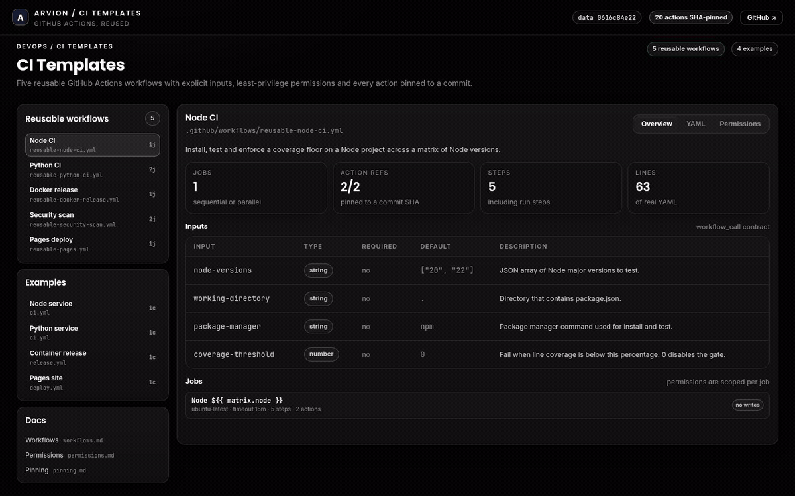
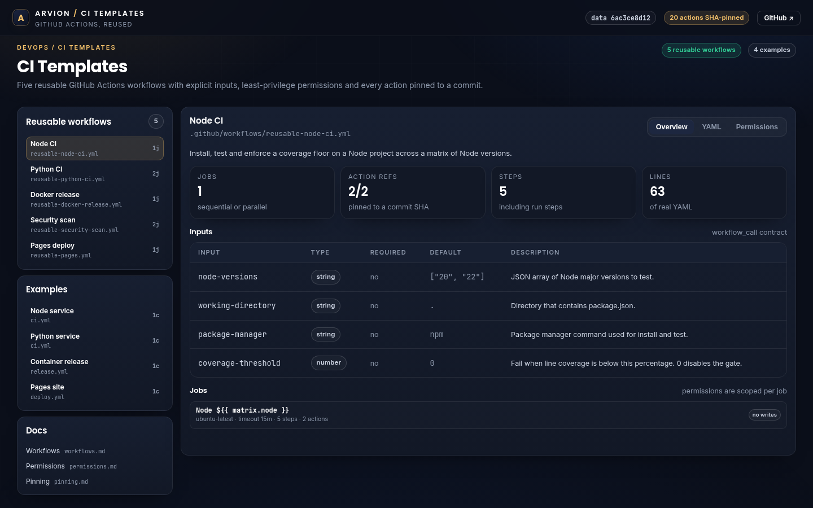
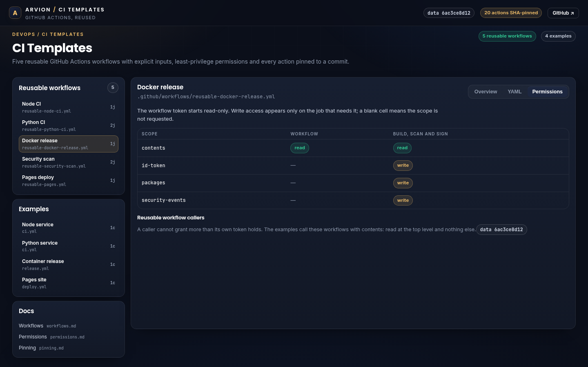

<div align="center">

</div>

<sub>Recorded from the live demo — <a href="docs/demo.mp4">MP4</a> · <a href="docs/screenshot.png">static frame</a></sub>

# CI Templates

Five reusable GitHub Actions workflows you can call from a repository instead of
copying YAML into every project: Node and Python CI, a Docker release with SBOM,
Trivy scan and cosign signature, CodeQL plus dependency review, and a Pages
deploy. Every third-party action is pinned to a commit SHA, and write
permissions exist only on the job that needs them.

[**Open the live demo**](https://arvion-technology.github.io/labs/demos/ci-templates/) · [MIT](LICENSE)

---

Workflow YAML is copied between repositories more than almost any other code.
The copy drifts: one repo caches npm, another forgets to, one pins `actions/checkout@v4`
and another inherits whatever `v4` means today. Reusable workflows solve the
duplication, but only if their contract (inputs, secrets, permissions) is
explicit. That is what this repository is: five workflows with a documented
surface and a validator that refuses the usual ways a workflow turns into a
security problem.

## What it does

- **`reusable-node-ci.yml`** — Node matrix, `npm ci`, tests, optional coverage
  gate, caller-supplied working directory.
- **`reusable-python-ci.yml`** — Ruff and pytest with coverage across a Python
  matrix.
- **`reusable-docker-release.yml`** — multi-platform build with provenance and
  SBOM, Trivy scan that fails on high/critical, SARIF upload, keyless cosign
  signature.
- **`reusable-security-scan.yml`** — CodeQL with security-and-quality queries,
  and dependency review on pull requests.
- **`reusable-pages.yml`** — deploys an artifact produced by the caller.
- **Four examples** — complete caller workflows for a Node service, a Python
  service, a tagged container release and a Pages site.
- **A validator** — parses every workflow, checks `workflow_call` inputs, pins,
  permissions, triggers and untrusted expression interpolation, and runs on
  `npm test`.

## Screenshots

| Workflow overview | Permissions matrix |
| --- | --- |
|  |  |

## Architecture

```text
.github/workflows/
├── reusable-node-ci.yml          workflow_call, no writes
├── reusable-python-ci.yml        workflow_call, no writes
├── reusable-docker-release.yml   packages + id-token + security-events, job-scoped
├── reusable-security-scan.yml    security-events, pull-requests, job-scoped
├── reusable-pages.yml            pages + id-token, job-scoped
└── ci.yml                        this repository: tests + validator

examples/
├── node-service/                 caller: node-ci
├── python-service/               caller: python-ci
├── container-release/            caller: docker-release on v* tags
└── pages-site/                   build + upload, then pages deploy

src/yaml.js      workflow YAML reader (no dependencies)
src/validate.js  structural + security checks
src/catalog.js   human descriptions used by the docs and the demo
scripts/         validate.mjs, build-data.mjs
demo/            explorer generated from the real workflow files
```

`scripts/build-data.mjs` parses the workflows and writes `demo/data.js`, including
a hash of every tracked file. A test recomputes that hash, so the explorer cannot
show a workflow that no longer exists.

## Quickstart

```bash
git clone https://github.com/arvion-technology/ci-templates.git
cd ci-templates
npm test                  # 22 tests, no dependencies
npm run validate          # workflow checks; actionlint when installed

node scripts/build-data.mjs
npm run demo              # explorer on http://localhost:4173
```

Calling a workflow from a repository:

```yaml
name: CI
on:
  push:
    branches: [main]
  pull_request:

permissions:
  contents: read

jobs:
  node:
    uses: arvion-technology/ci-templates/.github/workflows/reusable-node-ci.yml@v1
    with:
      node-versions: '["20", "22"]'
      coverage-threshold: 80
```

A release caller passes registry secrets explicitly:

```yaml
jobs:
  image:
    uses: arvion-technology/ci-templates/.github/workflows/reusable-docker-release.yml@v1
    with:
      image-name: ghcr.io/example/service
    secrets:
      REGISTRY_USERNAME: <github-actor>
      REGISTRY_PASSWORD: <registry-token>
```

## How it works

**Permissions are minimised at the workflow level and escalated in one job.**
Every reusable workflow starts with `permissions: contents: read`. The release
workflow adds `packages`, `id-token` and `security-events` writes on its single
build job; the Pages workflow adds `pages` and `id-token` on the deploy job.
`src/validate.js` encodes which writes are allowed in which workflow, so a
contribution that adds `contents: write` to the Node CI fails the suite rather
than merging quietly. The demo's permissions tab renders the same table from the
parsed YAML.

**Actions are pinned by commit, not tag.** `actions/checkout@v4` moves when the
tag moves; `actions/checkout@11bd719...` does not. The validator walks every
`uses:` reference and fails on anything that is not a 40-character SHA, with an
exception for local actions and reusable-workflow references (the examples use
`@v1` so consumers receive compatible fixes; pin those to a SHA if your policy
requires review of every update). `docs/pinning.md` explains the update process.

**Untrusted expressions are rejected before a shell sees them.**
A `github.event.pull_request.title` expression in a `run:` block is a script injection
primitive on a fork pull request. The validator flags `github.event.*`,
`github.head_ref` and `github.ref_name` inside run steps, which pushes authors to
pass values through `env:` where a shell treats them as data. It also rejects
`pull_request_target` outright.

**Reusable workflow inputs are JSON strings, not arrays.** GitHub's
`workflow_call` inputs cannot be lists, so `node-versions`, `python-versions` and
`languages` are strings parsed with `fromJSON()` in the matrix. The contract
tables in the demo are generated from the YAML, not maintained by hand.

## Tests

```bash
npm test
```

22 `node:test` cases in three files. The YAML suite covers triggers, matrices,
block scalars and flow collections; the validator suite proves the repository
passes and then mutates copies to confirm each rule fires (tag-pinned action,
top-level write, `write-all`, write scope in the wrong workflow,
`pull_request_target`, event-title interpolation, undocumented input, missing
workflow, example that stops calling a reusable workflow, removed release
safeguard); the data suite checks the generated explorer against the files and
runs `scripts/validate.mjs` in both text and JSON modes.

```bash
node scripts/validate.mjs   # actionlint if installed, structural checks always
node scripts/build-data.mjs # regenerate demo/data.js after editing workflows
```

## Limitations

The workflows are templates, not a published, versioned action marketplace. The
examples reference `@v1`; there is no tag in this repository yet, so a real
consumer should pin the commit. `actionlint` is used when present but is not a
dependency; CI installs it separately if a project wants the stronger check. The
Node workflow assumes a lockfile and `npm ci`; pnpm and yarn need the cache and
install steps adjusted even though the input exists. The Python workflow assumes
a `pyproject.toml` with a `dev` extra. The Docker release assumes GHCR and OIDC;
other registries work by changing the login step. Workflows cannot be executed
in this repository's own CI without a target project, so the tests validate
structure and policy rather than running each template end to end.

## Project layout

```text
ci-templates/
├── .github/workflows/
│   ├── reusable-node-ci.yml
│   ├── reusable-python-ci.yml
│   ├── reusable-docker-release.yml
│   ├── reusable-security-scan.yml
│   ├── reusable-pages.yml
│   └── ci.yml
├── examples/
│   ├── node-service/.github/workflows/ci.yml
│   ├── python-service/.github/workflows/ci.yml
│   ├── container-release/.github/workflows/release.yml
│   └── pages-site/.github/workflows/deploy.yml
├── docs/                 # workflows, permissions, pinning
├── src/                  # YAML reader, validator, catalog
├── scripts/              # validate.mjs, build-data.mjs
├── test/                 # 22 node:test cases
└── demo/                 # explorer generated from the real workflows
```

## Credits

Built by [Arvion Technologies](https://arviontech.net) in Kathmandu as part of
our open-source [Labs](https://github.com/arvion-technology/labs) series. MIT
licensed.
